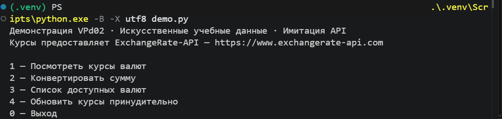
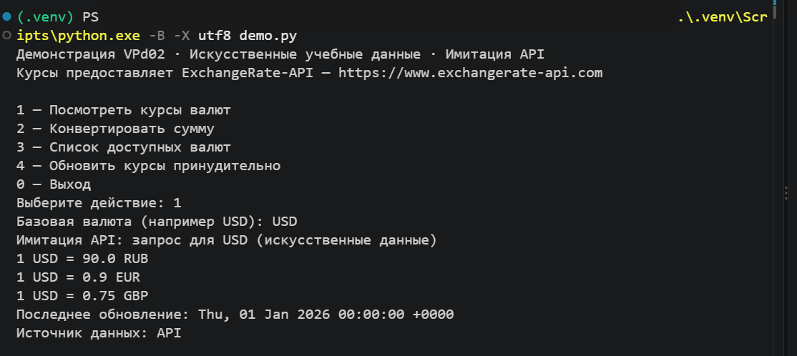
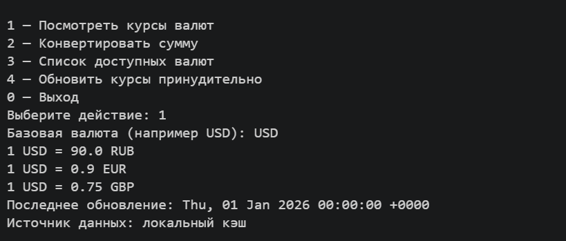
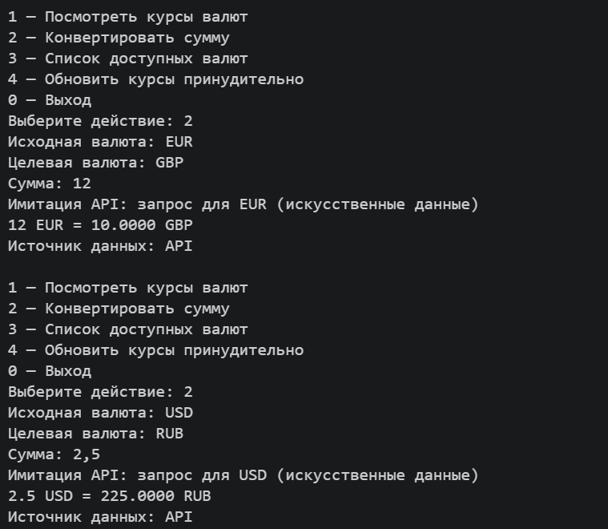
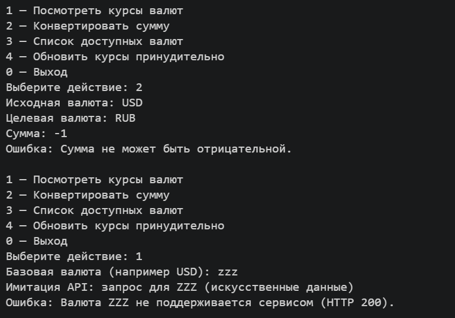
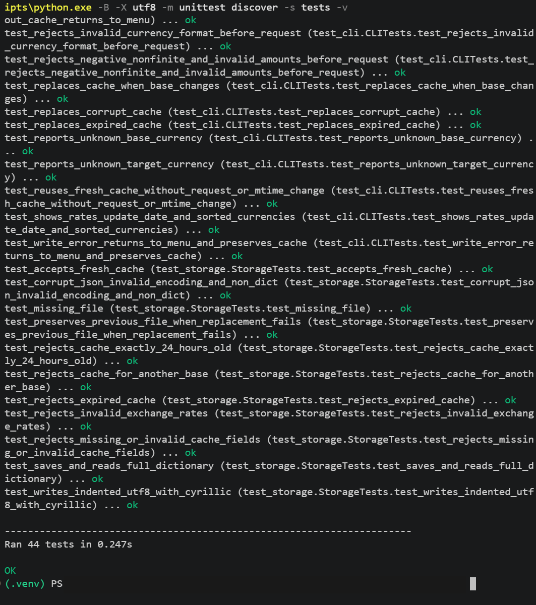

# VPd02 — Конвертер валют с кэшированием

VPd02 — консольное приложение на Python, разработанное в рамках модуля 5 курса по вайбкодингу. Оно получает курсы из открытого ExchangeRate-API, сохраняет ответ в локальный JSON-файл и использует его для повторных операций, пока кэш подходит для выбранной базовой валюты.

## Цели учебного задания

- Научиться отправлять HTTP-запросы, разбирать JSON и проверять данные внешнего сервиса.
- Реализовать файловый кэш с ограниченным сроком действия.
- Разделить работу с API, файловым хранилищем и консольным меню по модулям.
- Проверить расчёты и обработку ошибок автоматическими тестами с искусственными данными.

## Реализованная функциональность

- Получение актуальных для сервиса курсов через HTTP GET и разбор ответа в формате JSON.
- Выбор базовой валюты и просмотр курсов RUB, EUR и GBP с датой последнего обновления.
- Конвертация умножением суммы на курс. Расчёт выполняется с помощью `Decimal`, а результат выводится с четырьмя знаками после точки.
- Проверка кодов валют и суммы. Коды принимаются в любом регистре, сумма — с точкой или запятой. Нулевая сумма допустима. Для перевода валюты в саму себя используется курс 1.
- Повторное использование подходящего кэша младше 24 часов, в том числе без интернета.
- Принудительное обновление и вывод источника данных — API или локальный кэш.
- Алфавитный список валют из ответа для USD.
- Сообщения об ошибках ввода, сети, API, формата ответа и файловых операций.

## Технологии

| Технология | Назначение |
| --- | --- |
| Python 3.14.7 | Язык и версия среды, на которой проверен проект |
| `requests` 2.34.2 | HTTP-запросы |
| ExchangeRate-API | Источник курсов валют |
| JSON | Формат ответа API и локального файла |
| `unittest` | Запуск автоматических тестов |
| `unittest.mock` | Подмена HTTP-вызовов, ввода и отдельных файловых операций в тестах |
| VS Code | Редактор кода |
| Codex | Помощь при разработке, проверке и документировании проекта |

## Структура проекта

| Файл или каталог | Назначение |
| --- | --- |
| `currency.py` | Точка входа. Запускает меню и предоставляет совместимые импорты функций API и хранилища. |
| `cli.py` | Меню, проверка ввода, конвертация и выбор между API и кэшем. |
| `api_client.py` | Получение курсов, проверка ответа и исключение `CurrencyAPIError`. |
| `storage.py` | Запись и чтение JSON в UTF-8, проверка срока действия и содержимого кэша. |
| `requirements.txt` | Зафиксированные версии `requests` и её зависимостей. |
| `.gitignore` | Правила исключения локального кэша, виртуального окружения и служебных файлов. |
| `README.md` | Описание проекта, инструкции и примеры. |
| `tests/__init__.py` | Обозначает каталог тестов как пакет Python. |
| `tests/test_api_client.py` | Тесты HTTP-запросов, ошибок API и проверки ответа. |
| `tests/test_storage.py` | Тесты JSON, срока действия кэша и сохранности файла при ошибке записи. |
| `tests/test_cli.py` | Тесты меню, расчётов и совместной работы модулей. |
| `screenshots/` | Кадры демонстрации и тестов: `01_menu.png`, `02_api_rates.png`, `03_cached_rates.png`, `04_conversion.png`, `05_error_handling.png` и `06_tests.png`. |
| `.venv/` | Локальное виртуальное окружение, создаваемое при установке. |
| `currency_rate.json` | Локальный кэш, создаваемый после первого успешного запроса и записи. |

## Работа с API

Приложение отправляет HTTP-запрос методом GET. В адрес подставляется нормализованный код базовой валюты, например `USD`. Ответ приходит в формате JSON. Для открытого доступа ключ API не требуется. [Документация открытого API](https://www.exchangerate-api.com/docs/free)

```http
GET https://open.er-api.com/v6/latest/{base}
```

### Пять ключевых полей ответа

| Поле | Значение |
| --- | --- |
| `base_code` | Код базовой валюты, относительно которой заданы курсы. |
| `time_last_update_utc` | Время последнего обновления данных у поставщика в UTC. Показывается в меню просмотра курсов, если поле есть в ответе. |
| `time_next_update_utc` | Время следующего обновления данных у поставщика в UTC. Сохраняется в составе полного ответа и служит справочной информацией. |
| `rates.RUB` | Количество рублей за одну единицу базовой валюты. |
| `rates.USD` | Количество долларов США за одну единицу базовой валюты. При базе USD пример ответа API содержит значение 1. |

Сокращённый пример ответа с искусственными курсами.

```json
{
    "result": "success",
    "base_code": "USD",
    "time_last_update_utc": "Thu, 01 Jan 2026 00:00:00 +0000",
    "time_next_update_utc": "Fri, 02 Jan 2026 00:00:00 +0000",
    "rates": {
        "USD": 1,
        "RUB": 82.34567,
        "EUR": 0.90123,
        "GBP": 0.78123
    }
}
```

Открытый API возвращает словарь курсов в поле `rates`. Стандартный API с ключом использует для того же набора данных поле `conversion_rates`. VPd02 обращается к открытому API и читает `rates`. [Открытый API](https://www.exchangerate-api.com/docs/free) · [Стандартный API](https://www.exchangerate-api.com/docs/standard-requests)

Клиент проверяет статус HTTP 200, разбирает JSON и ожидает значение `success` в поле `result`. Если сервис возвращает `error` в этом поле, клиент читает `error-type` независимо от HTTP-статуса. Например, `unsupported-code` превращается в сообщение о неподдерживаемой валюте. При успешном ответе клиент сверяет `base_code` с запросом и проверяет, что `rates` — непустой словарь конечных положительных чисел. [Формат ответов открытого API](https://www.exchangerate-api.com/docs/free)

## Принцип кэширования

1. При первом запросе, когда подходящего файла нет, приложение обращается к API и сохраняет полный проверенный ответ в `currency_rate.json` в UTF-8.
2. При повторном запросе той же базовой валюты приложение использует файл, если ему меньше 24 часов и его данные проходят проверку. Чтение сохраняет время изменения файла.
3. Возраст считается от времени последнего изменения файла. Ровно через 24 часа кэш считается просроченным. Обновление происходит при следующем обращении за курсами. Поле `time_next_update_utc` не участвует в расчёте возраста файла.
4. Смена базовой валюты требует нового запроса. Кэш хранит ответ для одной валюты, поэтому после успешной записи новый ответ заменяет предыдущий. Пункт принудительного обновления обращается к API даже при свежем кэше.
5. Сетевой сбой или некорректный ответ прекращает обновление до записи. При сохранении программа сначала записывает временный файл целиком и затем заменяет им прежний кэш.

Файл создаётся в текущей рабочей папке. Для повторного использования одного и того же кэша запускайте приложение из папки проекта. Без интернета работают операции, для которых есть свежий и корректный кэш с нужной базовой валютой. Пункт списка валют использует базу USD. Принудительное обновление требует сети. Если кэш отсутствует, повреждён, просрочен или относится к другой валюте, при недоступности API приложение показывает ошибку и возвращается в меню.

## Установка и запуск в Windows PowerShell

Для воспроизведения учебной среды установите Python 3.14.7 и проверьте, что команда `python` доступна в PowerShell. Для будущего клонирования понадобится Git.

### Получение исходников

Планируемый адрес репозитория — [konstsherbakov/VPd02-currency-converter](https://github.com/konstsherbakov/VPd02-currency-converter). Репозиторий пока не создан. После публикации выполните в PowerShell из каталога, в котором хотите разместить копию проекта, команды для клонирования и перехода в неё.

```powershell
git clone https://github.com/konstsherbakov/VPd02-currency-converter.git
Set-Location .\VPd02-currency-converter
```

Если файлы проекта уже находятся на компьютере, откройте PowerShell в папке с `currency.py` и `requirements.txt`.

### Настройка среды и запуск

Из папки проекта проверьте версию Python, создайте и активируйте виртуальное окружение, установите зависимости и запустите приложение.

```powershell
python --version
python -m venv .venv
.\.venv\Scripts\Activate.ps1
python -m pip install -r requirements.txt
python currency.py
```

## Пункты меню

| Пункт | Действие |
| --- | --- |
| **1 — Посмотреть курсы валют** | Запрашивает базовую валюту. Показывает курсы RUB, EUR и GBP, время обновления и источник данных. |
| **2 — Конвертировать сумму** | Запрашивает исходную валюту, целевую валюту и сумму. Показывает результат с четырьмя знаками после точки и источник курса. |
| **3 — Список доступных валют** | Показывает в алфавитном порядке коды из таблицы курсов для USD. |
| **4 — Обновить курсы принудительно** | Запрашивает базовую валюту и получает ответ API независимо от срока действия кэша. |
| **0 — Выход** | Завершает приложение. |

## Примеры использования

Ниже приведены фрагменты вывода с искусственными курсами. Значения выбраны для примера и не взяты из локального кэша проекта.

### Просмотр курсов для USD

```text
Выберите действие: 1
Базовая валюта (например USD): usd
1 USD = 82.34567 RUB
1 USD = 0.90123 EUR
1 USD = 0.78123 GBP
Последнее обновление: Thu, 01 Jan 2026 00:00:00 +0000
Источник данных: API
```

### Конвертация с использованием того же свежего кэша

```text
Выберите действие: 2
Исходная валюта: USD
Целевая валюта: RUB
Сумма: 2,5
2.5 USD = 205.8642 RUB
Источник данных: локальный кэш
```

## Скриншоты работы приложения

Демонстрация выполнена с искусственными учебными курсами. Ответы API имитируются, поэтому показанные значения служат примерами и не являются реальными валютными котировками.

### 01. Главное меню

Консоль показывает заголовок демонстрации и пять пунктов меню.



### 02. Получение курсов через имитацию API

Первый запрос для USD показывает искусственные курсы RUB, EUR и GBP, дату обновления и источник «API».



### 03. Повторное чтение из локального кэша

Второй запрос для USD показывает те же курсы с отметкой «локальный кэш».



### 04. Конвертация валют

Два расчёта с четырьмя знаками после точки: 12 EUR → 10.0000 GBP и 2,5 USD → 225.0000 RUB.



### 05. Обработка ошибок

Программа выводит сообщения для отрицательной суммы и неподдерживаемого кода валюты `ZZZ`.



### 06. Результаты автоматических тестов

В конце прогона `unittest` показаны итог `Ran 44 tests` и статус `OK`.



## Автоматическое тестирование

Из папки проекта запустите команду PowerShell. Она использует Python из `.venv` и запускает все тесты из каталога `tests`.

```powershell
.\.venv\Scripts\python.exe -m unittest discover -s tests -v
```

| Набор тестов | Всего | Успешно | Провалено | Пропущено |
| --- | ---: | ---: | ---: | ---: |
| API-клиент | 12 | 12 | 0 | 0 |
| Хранилище | 11 | 11 | 0 | 0 |
| CLI и интеграция | 21 | 21 | 0 | 0 |
| **Итого** | **44** | **44** | **0** | **0** |

- **API-клиент:** нормализация кодов, успешный ответ, тайм-аут, ошибка соединения, HTTP-ошибки, `unsupported-code`, повреждённый JSON и недопустимые значения курсов.
- **Хранилище:** чтение и запись UTF-8, отсутствие или повреждение файла, граница в 24 часа, несовпадение базовой валюты и сохранность прежнего файла при ошибке замены.
- **CLI и интеграция:** повторное использование кэша, принудительное обновление, конвертация USD → RUB и EUR → GBP, проверка ввода, форматирование результата, обработка ошибок и выход из меню.

Тесты подменяют HTTP-вызовы и используют временные каталоги. Для их запуска доступ к ExchangeRate-API не нужен.

## Соответствие учебному заданию

### Базовый уровень

- [x] HTTP GET к ExchangeRate-API и проверка ответа.
- [x] Разбор JSON и работа с ключевыми полями ответа.
- [x] Локальное сохранение и чтение JSON в UTF-8.
- [x] Запуск через `python currency.py` и обработка ошибок API и файловых операций.

### Средний уровень

- [x] Консольное меню с пятью действиями и выбором базовой валюты.
- [x] Конвертация суммы с проверкой ввода и выводом до четырёх знаков после точки.
- [x] Просмотр курсов и алфавитный список доступных валют.
- [x] Проверка кэша на срок действия 24 часа и совпадение базовой валюты.
- [x] Работа с подходящим свежим кэшем без интернета и принудительное обновление по запросу.
- [x] Защита существующего файла при неудачном запросе или отклонённом ответе API.

## Источник данных и условия использования

Курсы предоставляет ExchangeRate-API. Ссылка на поставщика также отображается при запуске приложения. [ExchangeRate-API](https://www.exchangerate-api.com) · [Документация открытого API](https://www.exchangerate-api.com/docs/free)

Условия сервиса разрешают сохранять и повторно использовать данные для собственных задач и запрещают их распространение. Поэтому `currency_rate.json` создаётся локально и указан в `.gitignore`. Для публикации предназначены исходники и тесты с искусственными данными. [Условия использования ExchangeRate-API](https://www.exchangerate-api.com/terms)

## Автор

**konstsherbakov**
